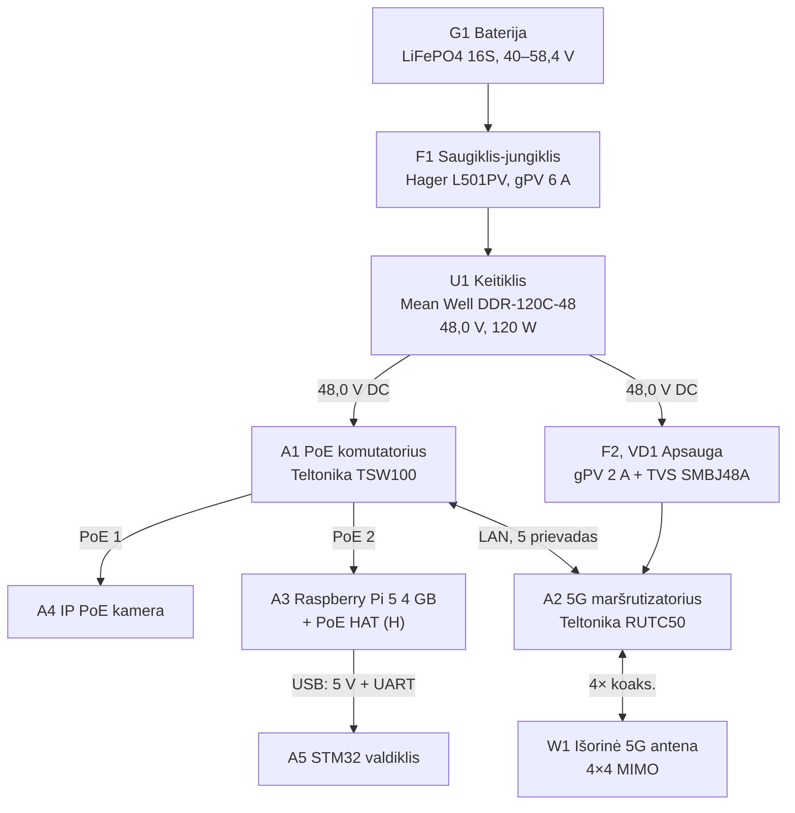

# Kerepetas 2026 – matavimo sistema

Matavimo sistema su PoE kamera, Raspberry Pi 5, STM32 valdikliu ir 5G ryšiu, maitinama iš 48 V LiFePO4 16S baterijos.

## Dokumentai

| Dokumentas | Failas |
| --- | --- |
| Blokinė schema (PDF) | [docs/blokine_schema.pdf](docs/blokine_schema.pdf) |
| Komponentų sąrašas (PDF) | [docs/komponentai.pdf](docs/komponentai.pdf) |

## Blokinė schema

## Svarbiausi parametrai

- **Baterija:** LiFePO4 16S, darbinė įtampa ~51–53 V, pilnai įkrauta iki 58,4 V.
- **48 V linija:** DDR-120C-48 išėjimą nustatyti tiksliai **48,0 V**. RUTC50 įėjimo riba yra 50 V, o TSW100 PoE išėjimui reikia ≥44 V.
- **Suvartojimas:** ~50 W (kamera ~10 W, Pi 5 ~20 W, RUTC50 iki ~18 W), apie 1 A iš baterijos.
- **Raspberry Pi 5:** į `/boot/firmware/config.txt` įrašyti `usb_max_current_enable=1`.
