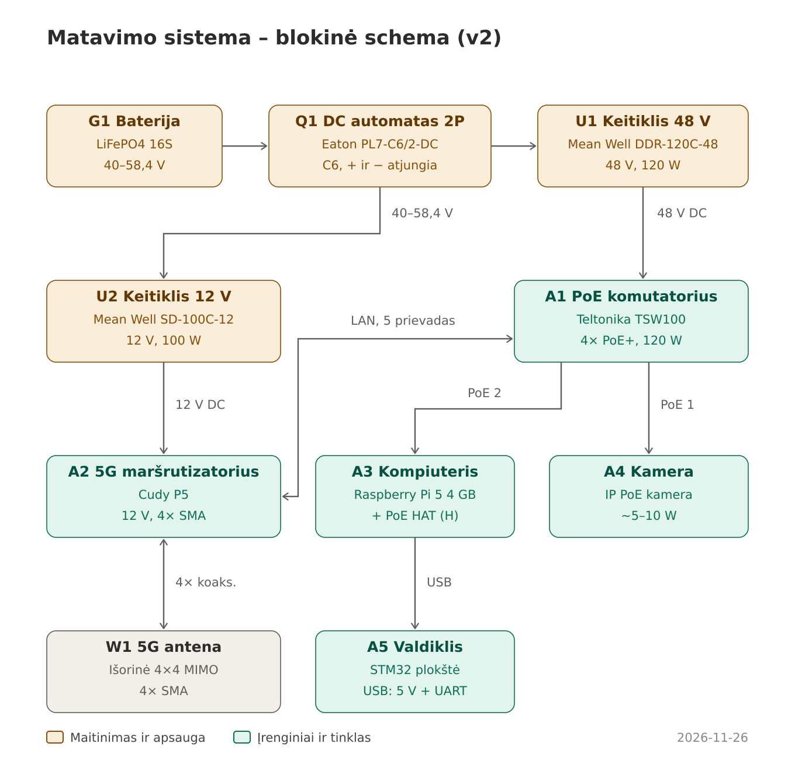

# Kerepetas 2026 – matavimo sistema

Matavimo sistema su PoE kamera, Raspberry Pi 5, STM32 valdikliu ir 5G ryšiu, maitinama iš 48 V LiFePO4 16S baterijos.

## Dokumentai

| Dokumentas | v2 (dabartinė) | v1 |
| --- | --- | --- |
| Blokinė schema | [docs/blokine_schema_v2.pdf](docs/blokine_schema_v2.pdf) | [docs/blokine_schema.pdf](docs/blokine_schema.pdf) |
| Komponentų sąrašas | [docs/komponentai_v2.pdf](docs/komponentai_v2.pdf) | [docs/komponentai.pdf](docs/komponentai.pdf) |

**v2 skiriasi nuo v1:** vietoj Teltonika RUTC50 naudojamas Cudy P5, maitinamas per atskirą 12 V keitiklį (Mean Well SD-100C-12). 48 V keitiklis U1 dabar maitina tik TSW100.

## Blokinė schema (v2)

## Pirkimo nuorodos (v2)

| Žymuo | Komponentas | Parduotuvė |
| --- | --- | --- |
| Q1 | Eaton PL7-C6/2-DC (2P DC automatas) | [aio.lv](https://aio.lv/en/product--eaton-264899--12453001) |
| U1 | Mean Well DDR-120C-48 | [Lemona](https://www.lemona.lt/en/120w-dc-dc-converter-33-6-67-2v-48v-2-5a-on-the-din-mean-well.html) · [TME](https://www.tme.eu/gb/details/DDR-120C-48/) |
| U2 | Mean Well SD-100C-12 | [Lemona](https://lemona.lt/en/100w-single-output-dc-dc-converter-36-72v-12v-8-5a-enclosed-mean-well.html) |
| A1 | Teltonika TSW100 | [Lemona](https://lemona.lt/teltonika-tsw100-poe-switch-5x-rj45-1000mb-s-4x-poe-60w-teltonika.html) |
| A2 | Cudy P5 1.0 | [Lemona](https://www.lemona.lt/en/modem-router-4-ports-cudy-p5-1-0.html) |
| A3 | Raspberry Pi 5 4 GB | [Lemona](https://www.lemona.lt/en/single-board-computer-raspberry-pi-5-b-4gb-ram.html) |
| A3 HAT | Waveshare PoE HAT (H) | [Waveshare](https://www.waveshare.com/poe-hat-h.htm?sku=30901) |

Jei Lemonos nuoroda neatsidaro, Lemonos paieškoje įvesk prekės kodą (pvz., `DDR-120C-48`).
PDF faile parduotuvių pavadinimai irgi yra nuorodos, bet GitHub peržiūroje jie neveikia – reikia PDF atsisiųsti.

## Svarbiausi parametrai (v2)

- **Baterija:** LiFePO4 16S, darbinė įtampa ~51–53 V, pilnai įkrauta iki 58,4 V.
- **48 V linija (U1):** maitina tik TSW100, paliekamas gamyklinis 48 V išėjimas (TSW100 PoE reikia ≥44 V).
- **Q1 apsauga:** 2 polių DC automatinis jungiklis Eaton PL7-C6/2-DC – atjungia ir +, ir −. DC automatai poliarizuoti, jungti pagal + / − ženklinimą.
- **12 V linija (U2):** jungiama po Q1 tiesiai nuo baterijos (įėjimas 36–72 V), maitina Cudy P5 (iki 25,2 W).
- **Cudy P5:** darbinė temperatūra 0…+40 °C – lauke reikia šildomos arba apsaugotos dėžės.
- **Suvartojimas:** ~55–60 W (kamera ~10 W, Pi 5 ~20 W, Cudy P5 iki ~25 W), apie 1,3 A iš baterijos.
- **Raspberry Pi 5:** į `/boot/firmware/config.txt` įrašyti `usb_max_current_enable=1`.
