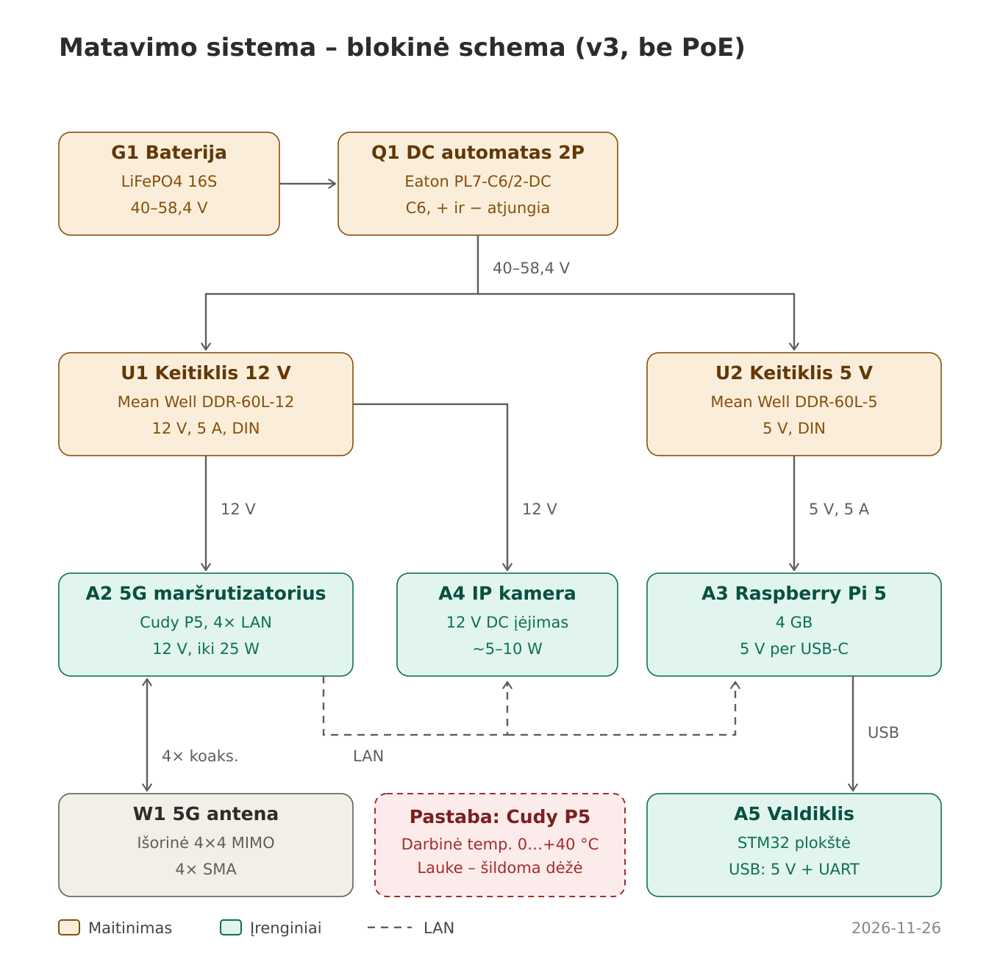

# Kerepetas 2026 – matavimo sistema

Matavimo sistema su IP kamera, Raspberry Pi 5, STM32 valdikliu ir 5G ryšiu, maitinama iš 48 V LiFePO4 16S baterijos.

## Dokumentai

| Dokumentas | v3 (dabartinė) | v2 | v1 |
| --- | --- | --- | --- |
| Blokinė schema | [blokine_schema_v3.pdf](docs/blokine_schema_v3.pdf) | [blokine_schema_v2.pdf](docs/blokine_schema_v2.pdf) | [blokine_schema.pdf](docs/blokine_schema.pdf) |
| Komponentų sąrašas | [komponentai_v3.pdf](docs/komponentai_v3.pdf) | [komponentai_v2.pdf](docs/komponentai_v2.pdf) | [komponentai.pdf](docs/komponentai.pdf) |
| Jungimo metodika | [jungimo_metodika_v3.pdf](docs/jungimo_metodika_v3.pdf) | – | – |

**v3 skiriasi nuo v2:** atsisakyta PoE – nebėra TSW100, 48 V keitiklio ir Pi 5 PoE HAT. Dvi linijos tiesiai nuo baterijos: 12 V (Cudy P5 ir kamera) ir 5 V (Raspberry Pi 5). Cudy P5 4× LAN prievadai atlieka komutatoriaus darbą.

**v2 skiriasi nuo v1:** vietoj Teltonika RUTC50 naudojamas Cudy P5, maitinamas per atskirą 12 V keitiklį.

## Blokinė schema (v3)

## ⚠️ Pastaba dėl modemo darbinės temperatūros

Cudy P5 gamintojo nurodyta darbinė temperatūra yra **0…+40 °C**. Lauke įrengtą sistemą reikia dėti į šildomą ir vėdinamą dėžę: žiemai – termostatu valdomas šildytuvas, vasarai – ventiliatorius arba šešėlis. Jei tokios temperatūros dėžėje palaikyti nepavyks, reikia rinktis pramoninį 5G maršrutizatorių su −40…+75 °C diapazonu.

## Pirkimo nuorodos (v3)

| Žymuo | Komponentas | Parduotuvė |
| --- | --- | --- |
| Q1 | Eaton PL7-C6/2-DC (2P DC automatas) | [aio.lv](https://aio.lv/en/product--eaton-264899--12453001) |
| U1 | Mean Well DDR-60L-12 (12 V) | [TME](https://www.tme.eu/gb/details/DDR-60L-12/) |
| U2 | Mean Well DDR-60L-5 (5 V) | [DigiKey](https://www.digikey.ie/en/products/detail/mean-well-usa-inc/DDR-60L-5/8681216) · [TME](https://www.tme.eu/gb/details/DDR-60L-5/) |
| A2 | Cudy P5 1.0 | [Lemona](https://www.lemona.lt/en/modem-router-4-ports-cudy-p5-1-0.html) |
| A3 | Raspberry Pi 5 4 GB | [Lemona](https://www.lemona.lt/en/single-board-computer-raspberry-pi-5-b-4gb-ram.html) |
| – | Lituojamas USB-C kištukas (U2 → Pi 5) | [Lemona](https://www.lemona.lt/kistukas-usb-c-tipo-kabelinis-lituojamas.html) |

PDF faile parduotuvių pavadinimai irgi yra nuorodos, bet GitHub peržiūroje jie neveikia – reikia PDF atsisiųsti.

## Svarbiausi parametrai (v3)

- **Baterija:** LiFePO4 16S, darbinė įtampa ~51–53 V, pilnai įkrauta iki 58,4 V.
- **Q1 apsauga:** 2 polių DC automatinis jungiklis Eaton PL7-C6/2-DC – atjungia ir +, ir −. Jungti pagal + / − ženklinimą.
- **12 V linija (U1):** įėjimas 18–75 V, maitina Cudy P5 (iki 25,2 W) ir kamerą (~5–10 W).
- **5 V linija (U2):** įėjimas 18–75 V, išėjimą pakelti iki 5,1–5,2 V, laidas iki Pi trumpas (≤30 cm, 0,5–0,75 mm²), jungti per lituojamą GOOBAY USB-C kištuką (aikštelės V ir G) – žr. [jungimo metodiką](docs/jungimo_metodika_v3.pdf).
- **IP kamera:** turi turėti 12 V DC įėjimą.
- **Suvartojimas:** ~45–55 W, apie 1 A iš baterijos.
- **Raspberry Pi 5:** EEPROM'e (`sudo rpi-eeprom-config --edit`) įrašyti `PSU_MAX_CURRENT=5000`; papildomai galima `/boot/firmware/config.txt` → `usb_max_current_enable=1`.
